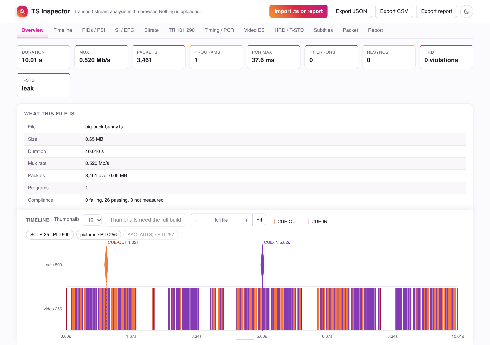

# TS Inspector

An MPEG-2 transport-stream inspector in one HTML file. Drop a `.ts` on it and read the PIDs, PSI/SI, SCTE-35, bitrate, timing, buffer models, and TR 101 290 checks. Nothing is uploaded.

**[Open it in your browser](https://hamza-u.github.io/ts-inspector/)**, then press **Try the sample stream**, or [open it with the sample loaded](https://hamza-u.github.io/ts-inspector/#sample).



- **Local only.** No server, no network calls. Parsing runs in a Web Worker.
- **One file.** Works from `file://` or any static host.
- **MIT.** See [License](#license).

**Status:** no release yet. File analysis works. Live input is not implemented.

## Quickstart

Needs Python 3.9+ and Node.js 20+.

```sh
python3 build.py --no-gpl
open dist/ts-inspector.html        # Linux: xdg-open
```

Drop a `.ts`, use **Import .ts**, or press **Try the sample stream**. Click an error row to jump to its packet. **Export JSON**, **Export CSV**, and **Export report** save to your machine.

`--no-gpl` builds the MIT-only page: about 1.2 MB with the sample, 300 kB with `--no-sample`. For captions, teletext SRT, the SCTE-35 cross-check, stills, and loudness, see [Full build](#full-build). Those controls are disabled on the MIT-only page.

## Sample stream

`samples/big-buck-bunny.ts` is 10 seconds of [Big Buck Bunny](https://www.bigbuckbunny.org), (c) 2008 Blender Foundation, [CC BY 3.0](https://creativecommons.org/licenses/by/3.0/). It is H.264 and AAC at a constant 520 kb/s, with NIT, SDT, EIT, TDT, and a SCTE-35 cue-out and cue-in. It fails no check. `python3 scripts/make_sample.py` rebuilds it from the official Blender release, byte for byte with the same FFmpeg and x264 versions. See [`samples/NOTICE`](samples/NOTICE).

## What it shows

| Area | Contents |
|---|---|
| Framing | 188-byte TS, 192-byte M2TS, 204-byte packets |
| Tables | PAT, PMT, SDT, NIT, EIT (EPG per service), TDT/TOT, SCTE-35, with descriptors and EN 300 468 text |
| PIDs | Stream names from type and descriptors, per-PID bitrate scaled by the PCR rate |
| Checks | ETSI TR 101 290 style, priorities 1 to 3, and a pass/fail/not-measured compliance table |
| Timing | PCR interval and accuracy (±500 ns against a linear fit), PTS/DTS against PCR |
| H.264 | SPS/PPS, SEI, GOP structure, access-unit sizes |
| Buffers | Annex C HRD (CPB fullness, buffering-period joins), H.222.0 2.14.3.1 T-STD (TB, MB, EB) |
| Subtitles | Teletext (EN 300 706), DVB subtitles drawn from their pixel data (EN 300 743) |
| Captions | CEA-608/708 from H.264 SEI, decoded by CCExtractor *(full build)* |
| Cross-checks | Teletext against telxcc, SCTE-35 against libklscte35 *(full build)* |
| Timeline | I-frame stills, SCTE-35 cue-out/in, I/P/B frames, subtitles, captions, EBU R 128 loudness lane. Zoom and pan |
| Packet | Hex view with header, adaptation field, PCR, and PES timestamps |

**Limits.** Time comes from PCR: a file has no arrival clock, so PCR_OJ, drift, and delivery jitter are not measured. HRD and T-STD cover H.264 only. CAT is listed, not checked. The checks are a subset of TR 101 290, not a conformance certificate.

## Command line

The same analysis in Node, writing a versioned JSON report. Drop the report on the page to view it.

```sh
node bin/ts-inspector.js capture.ts -o capture.report.json
node bin/ts-inspector.js capture.ts --summary --fail-on fail
```

| Option | Effect |
|---|---|
| `--summary` | Print pass, fail, and not-measured counts |
| `--fail-on fail` | Exit 1 if any compliance row failed. Unreadable file: exit 2 |
| `--audio` | EBU R 128 loudness, using `ffmpeg` on `PATH` |
| `--thumbs [N]` | N I-frame stills, default 12, using `ffmpeg` on `PATH` |
| `--captions` | CEA-608/708 as SubRip *(needs `vendor/`)* |
| `--teletext-srt DIR` | One `.srt` per teletext page *(needs `vendor/`)* |
| `--scte-check`, `--fail-on-diff` | Cross-check SCTE-35 with libklscte35 *(needs `vendor/`)* |

## Full build

Adds FFmpeg, CCExtractor, telxcc, and libklscte35, compiled to WebAssembly. Sources are cloned at pinned commits.

```sh
brew install emscripten            # or an emsdk environment
python3 scripts/build_wasm.py      # vendor/ccextractor, telxcc, libklscte35
python3 scripts/fetch_ffmpeg.py    # vendor/ffmpeg
python3 build.py                   # dist/ts-inspector.html, about 44 MB
```

Or download `ts-inspector-full.html` from [Releases](https://github.com/hamza-u/ts-inspector/releases), with its source archive. A full page is GPL-2.0. See [License](#license).

## Develop

```sh
node --test test
python3 scripts/make_fixtures.py   # regenerate test/fixtures
python3 scripts/make_sample.py     # regenerate the sample (needs ffmpeg)
node scripts/screenshot.mjs        # regenerate docs/screenshot.png (needs Chrome)
```

`test/golden/` holds the expected results for each fixture. Tests that need `vendor/` skip without it.

This project uses AI-first development. Coding agents write most of the code, tests, and docs, working from [`AGENTS.md`](AGENTS.md) and [`.agents/skills/`](.agents/skills/README.md). A person sets direction, reviews every change, and decides what is merged. Decisions that are hard to reverse are in [`docs/adr/`](docs/adr/README.md).

## Roadmap

Live input: follow a growing file, read UDP/RTP through a small local helper, and measure arrival-time metrics (datagram spacing, media delivery index). The file inspector stays as it is.

## License

The TS Inspector sources are [MIT](LICENSE).

A full build also embeds:

| Component | Licence |
|---|---|
| FFmpeg core (`@ffmpeg/core` 0.12.6) | GPL-2.0-or-later |
| CCExtractor | GPL-2.0-only |
| telxcc | GPL-2.0-or-later |
| libklscte35 | LGPL-2.1-or-later |

These ship in one file, so a full page is distributed under GPL-2.0. If you host one, offer the corresponding source from the same place: this repository and each upstream at the commit in `vendor/<name>/NOTICE`. The `--no-gpl` page is MIT only, and is what GitHub Pages publishes. [ADR-0001](docs/adr/0001-mit-licence.md) explains the choice.

The sample stream is CC BY 3.0, as above. Every built page names it in its header comment.

ISO, ETSI, and SCTE specifications are not included. Get them from their publishers.
